# SC-LAB-007 | Exploración guiada de APIs REST y GraphQL

**Estudiante:** Ángeles Dávila Rodríguez  
**Materia:** Desarrollo Seguro  
**Fecha:** 18 de noviembre de 2026

## Objetivo

Explorar las APIs REST y GraphQL de SecureCampus y comprobar la autenticación, autorización y validación de datos.

## Configuración

Se configuró Python 3.12.10, se creó el entorno virtual, se instalaron las dependencias y se ejecutó SecureCampus localmente con `python run.py` en `http://127.0.0.1:5000`.

## Experiencia A: REST GET

Con la profesora Ana, la consulta del estudiante 3 y grupo 10 devolvió HTTP 200. Al cambiar a estudiante 4 y grupo 20 se obtuvo HTTP 403. La autenticación no sustituye la autorización.

**Consulta autorizada**

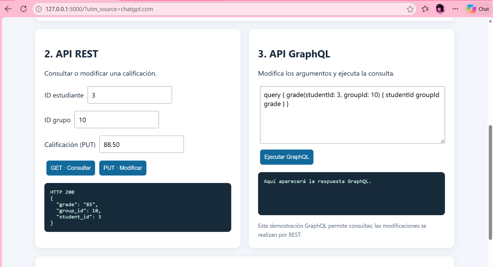

**Consulta denegada**

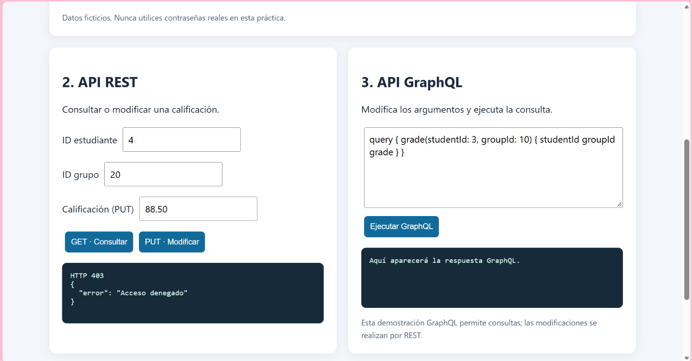

## Experiencia B: REST PUT

Ana guardó la calificación 88.50 y verificó el cambio con GET. El intento de modificar otro grupo devolvió 403 y la calificación 150 devolvió 400.

**Modificación autorizada**

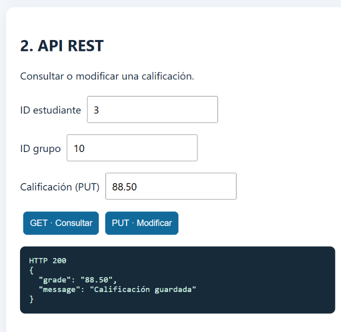

**Verificación del cambio**

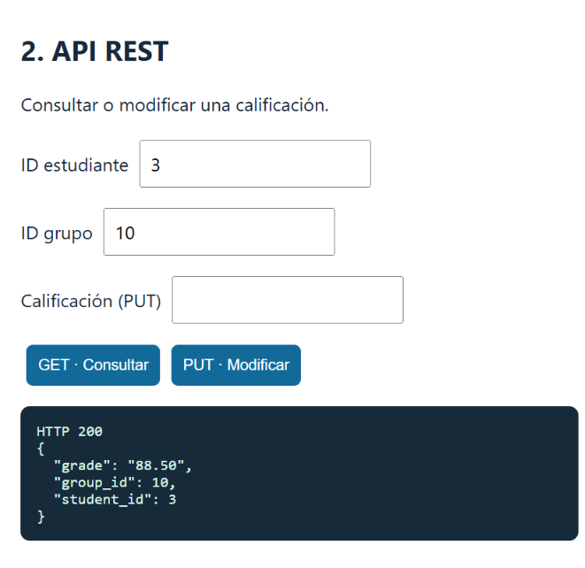

**Modificación denegada**

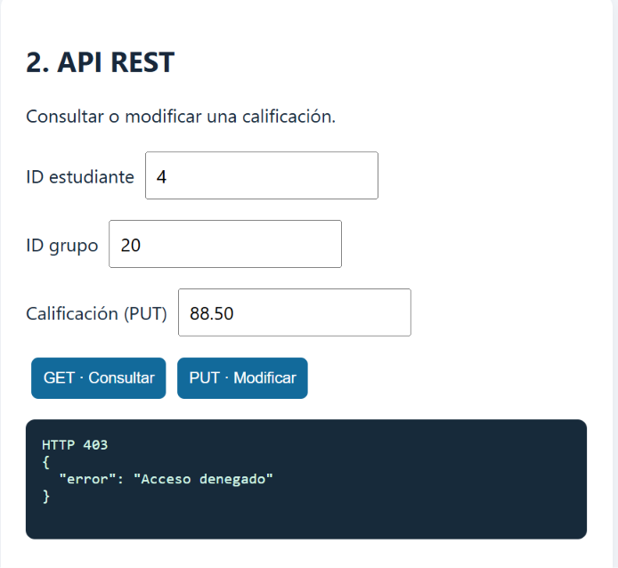

**Calificación inválida**

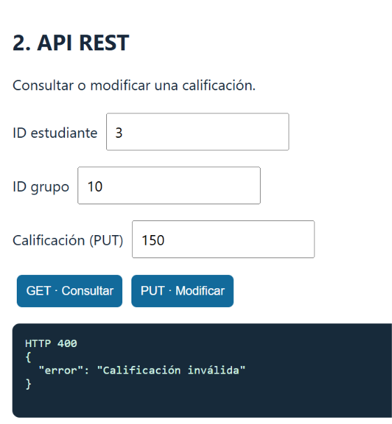

## Experiencia C: control de acceso como estudiante

Eli pudo consultar su propia calificación, pero no consultar la de otro estudiante ni modificar la suya.

**Consulta propia**

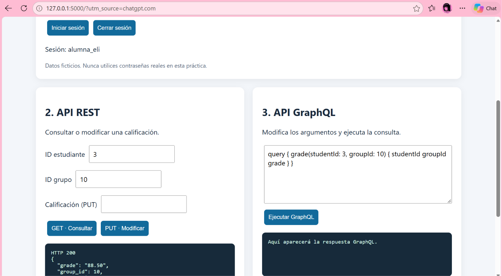

**Consulta ajena denegada**

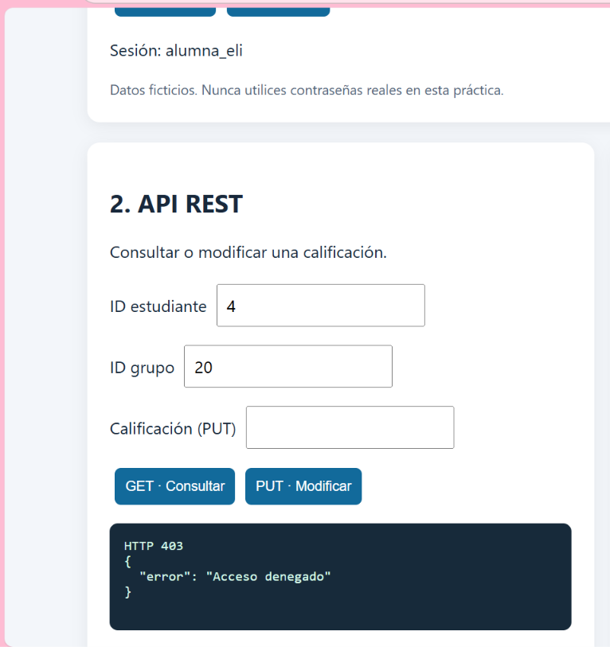

**Modificación denegada**

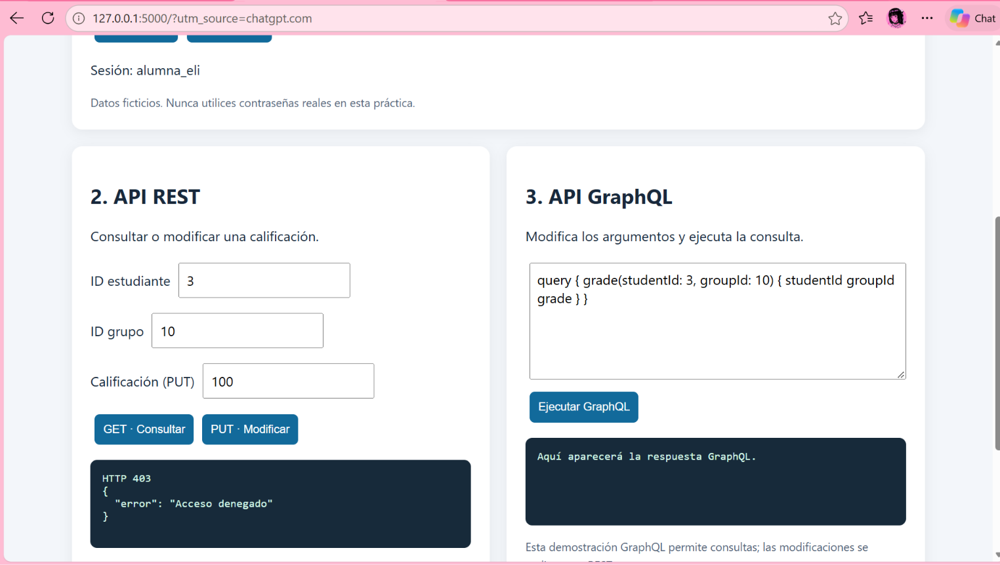

## Experiencia D: GraphQL

Con Eli se comprobó que la consulta propia devuelve 200, la ajena 403 y que es posible seleccionar únicamente el campo grade.

**Consulta autorizada**

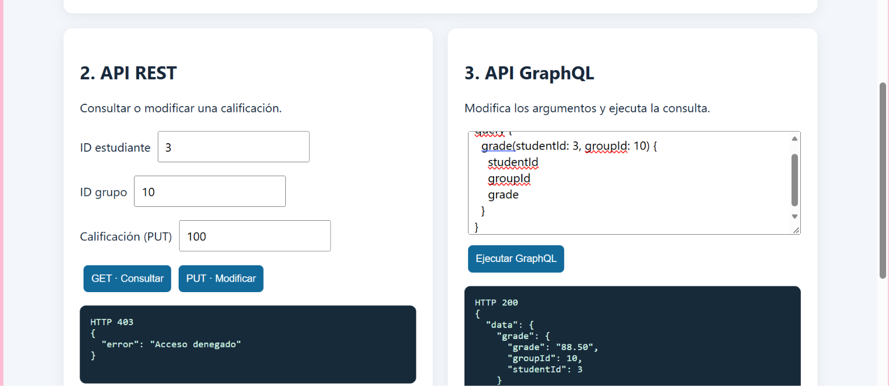

**Consulta denegada**

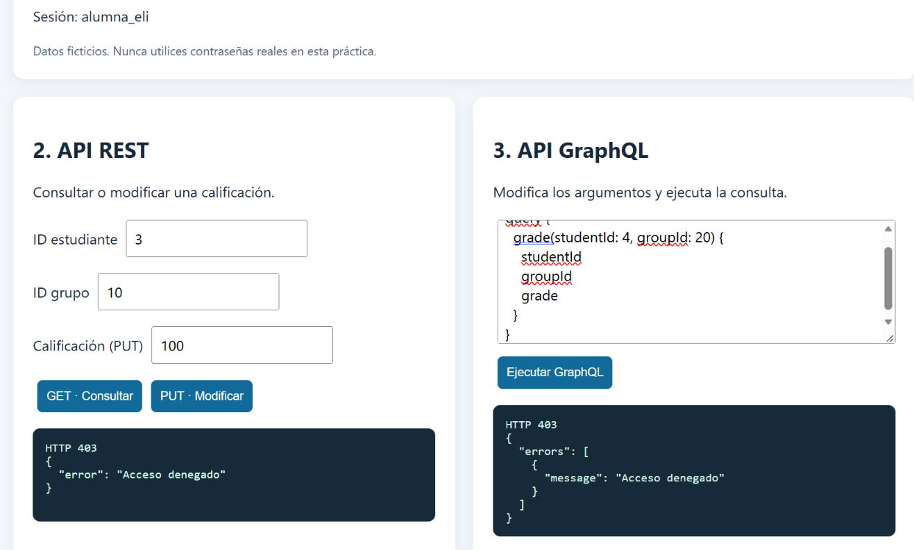

**Selección de campos**

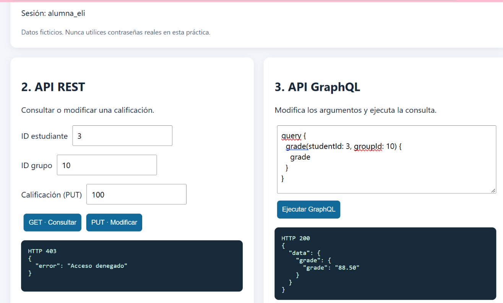

## Pruebas automatizadas

Se ejecutó `python -m pytest -v` y se obtuvieron **18 pruebas aprobadas en 16.98 segundos**.

**Resultado de pytest**

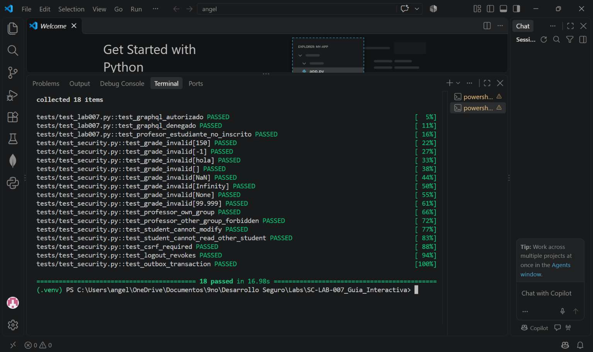

## Preguntas de reflexión (apartado 17)

1. **¿Qué significa 200, 400, 401 y 403?**  
   200 indica éxito; 400, solicitud inválida; 401, falta de autenticación válida; y 403, acceso denegado por falta de permisos.
2. **¿Qué diferencia existe entre iniciar sesión y tener autorización?**  
   La autenticación identifica al usuario y la autorización determina qué puede consultar o modificar.
3. **¿Por qué una persona no debe poder consultar calificaciones de otros estudiantes cambiando los identificadores?**  
   Porque se vulneraría su privacidad y existiría una falla de control de acceso.
4. **¿Qué cambia al consultar una calificación por REST o por GraphQL?**  
   REST identifica el recurso mediante una ruta; GraphQL permite elegir los campos de la respuesta. Ambos comprueban permisos.
5. **¿Qué pasaría si GraphQL omitiera la comprobación de permisos?**  
   Se podrían consultar calificaciones ajenas sin autorización.

## Conclusión

Las pruebas permitieron comprobar que SecureCampus restringe el acceso según los permisos, valida las calificaciones y permite seleccionar campos mediante GraphQL. Las 18 pruebas automatizadas fueron exitosas.

> Evidencia educativa con datos ficticios. No se incluye la base de datos ni el entorno virtual.
